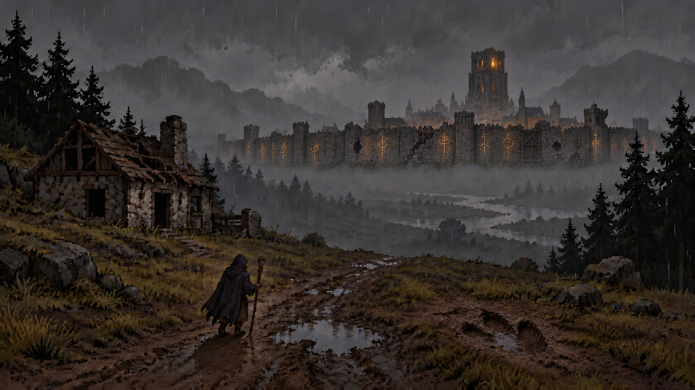
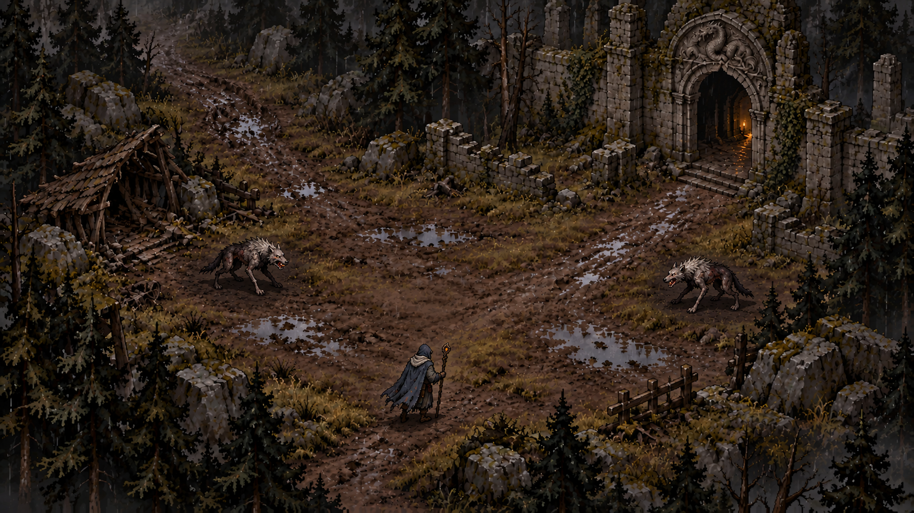

# WyrmForge art direction

## Approved world concept — 14 October 2026

This approved concept establishes the atmosphere and environment direction. It is concept art, not a production tileset or a commitment to the gameplay camera.

- Grounded dark fantasy inspired by the atmosphere of original Diablo II, expressed in pixel art.
- Restrained composition, clear silhouettes, selective detail; avoid random clutter and ornate spectacle.
- Wet forests, abandoned villages, ruined monasteries, muted earth colours, rain and mist.
- Humanity survives in a few great protected cities. Their magical engines consume an increasingly scarce substance whose origin is concealed.
- Protective runes are carved into the city walls, not suspended in the sky. Some glow; others are damaged, dim, or extinguished.
- Walls are battered and repeatedly repaired: broken battlements, impact scars, cracks, mismatched masonry and timber reinforcement.
- Protection should feel necessary but precarious: it protects us, but for how long?
- Creature tracks should look pressed into wet terrain, with irregular collapsed edges and pooled water, rather than clean stamped icons.

## World and progression decisions

- Wyrms were once sacred protectors; something changed them. Their relationship to the engines remains deliberately unresolved.
- The player is a mage seeking enough strength to save or rule the world.
- Defeated enemies and wyrms grant temporary power within a run. Lost spells and combined forbidden knowledge support progression across runs.
- Power visibly changes the mage; dangerous abilities carry manageable costs, with occasional consequential sacrifices.
- Successful hunts can enable real recovery, while larger consequences remain uncertain.
- Optional rare creatures promise powerful loot and experience. Environmental evidence helps players judge danger before committing.
- Elemental influence changes the environment and strengthens closer to the wyrm.

## Provenance

Generated with OpenAI image generation and iteratively art-directed with Pjotr. This is the approved final revision with wall-mounted failing runes, battered defences, and the weathered footprint. Earlier exploratory revisions are not the approved reference.

## Approved forest encounter — 14 October 2026

Approved gameplay-view environment study: an open forest clearing, ruined monastery entrance, a mage and two scavengers. This is concept art rather than a production tileset.

### Character readability

- Characters must remain immediately distinguishable from the terrain at mobile viewing size.
- The mage uses a muted slate-blue cloak, pale collar and clear staff silhouette.
- Scavengers use lighter bone-gray faces and upper backs with dark undersides and separated limbs.
- Quiet ground textures near characters; maintain value and restrained colour separation.
- Preserve grounded dark fantasy atmosphere without relying on glowing outlines, circles or UI markers.
- Apply this readability principle to every environment, enemy and mage progression state.

Generated with OpenAI image generation and iteratively art-directed with Pjotr; approved after the character contrast revision.
