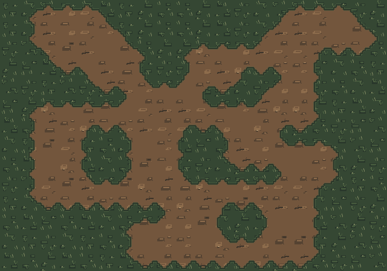

# WF32 AR4-BF Wet Forest compacted-road study v2 (source-only, unapproved)

> **WET FOREST ONLY**. Mountain Pass and monastery-region ground are parked by owner direction. This preview is an authored source-art **stress map**, **not gameplay proof** or AR4-BF visual approval. Track [issue #465](https://github.com/pjotrcasteel/Wyrmforge/issues/465).

**Changes from rejected v1**: retain the 16 Wang corner silhouettes and eight variant slots; substantially lower the frequency of pebble/clast marks (rare, 0–1 per selected tile rather than three repeating per 32px cell), and replace them with quieter broad soil masses, sparse compressed root strands and shallow worn depressions. The warm-brown ramp is taken toward the existing original **`trampled-earth`** concept rather than a pale biscuit field. The authored original **`grass-moss`/`wet-mud`** references guide the banks and future mud families, but the 1024px concept illustrations are not copied/pasted onto world geometry or treated as seamless source tiles.

**Still missing / not approved:** the repeat-resistant 64–96px-scale road cluster/track grammar, natural root-to-verge transitions, mud/earth junctions, a truly editable Aseprite/Tiled art document, and genuine mobile Hunt review. A 1× stress board proves seam connectivity, not production art. The current grass-world `source32c` remains our positive in-game baseline; C# owns every road/collider/grade.

B1 source: [`tools/art/prototypes/ar4-wf32-terrain-wang.mjs`](../../../../tools/art/prototypes/ar4-wf32-terrain-wang.mjs), manifest `manifest.json`, atlas `atlas.png`. Reproduce with `node tools/art/prototypes/ar4-wf32-terrain-wang.mjs docs/art/previews/wf32-ar4b-road-v2`. 5 focused Wang seam/source tests remain mandatory.

The **next** review must be an actual **320×568 Wet Forest Hunt** screenshot, including player/camera motion; both should be visibly embedded in owner chat. **Do not** treat this sheet or passing tests as owner's AR4-BF approval. PR #459 stays draft/unmerged.
