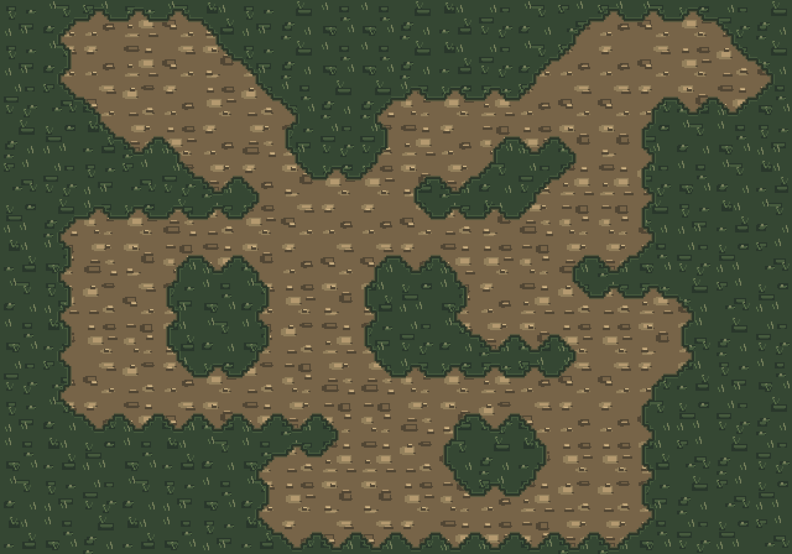

# WF32 AR4-B1 — original authored 32px Wang-road study (unapproved)

> **SOURCE-ONLY ART STRESS TEST — NOT A GAME CAPTURE OR VISUAL APPROVAL.** See [tracking issue #465](https://github.com/pjotrcasteel/Wyrmforge/issues/465). Do not mistake this generated stress-map screenshot for real in-Hunt footage. Previous `source32d` remains the rejected in-game baseline.

- A 32px source atlas `atlas.png` contains **146 immutable authored tiles**: 8 grass interiors, 8 earth interiors, 2 provisional mud interiors and **16×8 grass↔earth/road Wang corner masks with source-authored 4px contour silhouettes**. `manifest.json` explicitly lists every 32×32 frame and the mask bit order NW, NE, SE, SW. The generator is [ar4-wf32-terrain-wang.mjs](../../../../tools/art/prototypes/ar4-wf32-terrain-wang.mjs).
- The 20×14 **adversarial demo board** is designed to reveal hard bends, narrow routes, intersections, split borders, concave pockets and scale-dependent repetition; it is **not** C# site geography. Three colors/marks do not constitute an accepted full road grammar, and first 16 masks do not solve path-width semantics by themselves.
- **Honest assessment:** this proves crisp pixel sizes, seam topology and no per-pixel noise. At native scale, the sandy road still looks too uniform on broad areas, with visible repeated mineral clusters. It lacks directional wheel-rut language, packed-dirt center/grass verge differentiation and C# exact road-contour integration. These are **B1 refinement and B2 acceptance blockers**, not solved by green tests. Native source-sheet and artist review remain open.
- Mud↔earth, mud↔grass and mountain cliff transition families are **not yet authored**. Ground-first priority; monastery buildings remain deferred.
- Studio-drawn contour stencils and feature coordinates are editable JS source; Aseprite/Tiled-compatible **round-trip editable source export** is still an open deliverable. This is deliberately not described as hand-painted Aseprite work.
- Tests: `node --test tests/javascript/ar4-wf32-terrain-wang.test.mjs` checks all east/west+north/south allowed pair seams, 146 frame footprints, all quadrants, deterministic board identity and native nearest 3×. Tests do **not** establish art quality.

**Next step:** iterate interiors/road-bank language with authentic reference review, then implement a presentation-only B2 resolver from authoritative AR3 C# road/mask fields. Capture Town→Chart→Hunt at 320/390px with the new mode **before asking for AR4-B approval**. Keep PR #459 draft and #429 intact.

Actual **in-Hunt** B2 review has now exposed clear repetition: [new 320/390px playable Hunt screenshots](../../../evidence/ar4-b-wang-road-study-2026-11-01/README.md). This source sheet stays unapproved.
