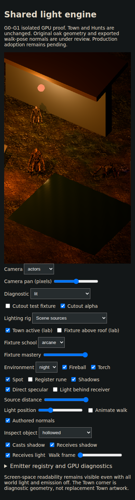
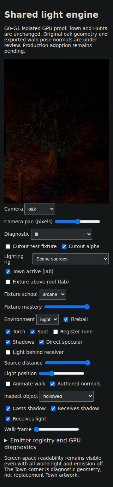

# G1 whole-pixel temporal evidence — 25 October 2026

[Published-app GPU run 40171667444](https://github.com/pjotrcasteel/Wyrmforge/actions/runs/40171667444) passed both 320×568 and 390×844 cases at head `0c75ab3`. The complete artifact 12591145405 expires 24 November; original checksums and tested PR merge SHA are recorded in provenance.json.

| View | Maximum translated-image mismatch at 320 | At 390 |
| --- | ---: | ---: |
| Actors | 0.1030% | 0.0884% |
| Oak | 0.1744% | 0.1395% |
| Water | 0.0854% | 0.0785% |

Pans move the camera by 1, 2, 4, 8, 4, 2 and 1 internal framebuffer pixels. Sources and shadow cameras stay fixed in world space. Each current image is compared against the appropriately shifted original, excluding outer columns and one row at each edge. An interior pixel differs if summed absolute RGB error exceeds 3; the acceptance ceiling is 1%. The small residual differences mean this is bounded stability, not exact translation invariance.

Returning the camera restores the exact framebuffer hash in all three views. Two deterministic runs of all 16 existing walk poses with matching light positions produce 16 distinct, identically replayed frame hashes at each size. Resize/restore preserves the exact image, texture/geometry counts and selected lights. This tests deterministic pose sampling, not realtime animation frame pacing. Fractional-pixel movement, physical-device FPS/thermal behavior and complete art acceptance remain unverified.

The canvas now precedes controls, so the world appears immediately on a phone. These original normal-night captures were visually inspected: local warm lighting reveals the actors, while the oak is dark at this source position. They are diagnostic composition, not owner-approved Gothic-night artwork or production Town assets.

