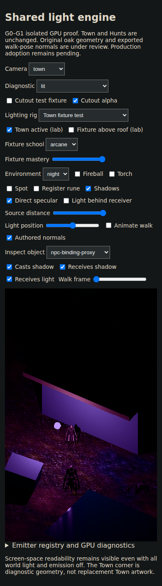
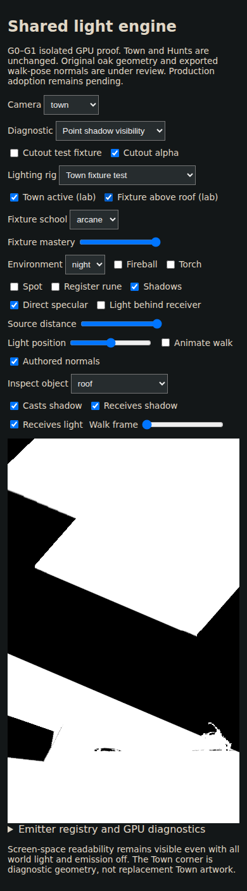
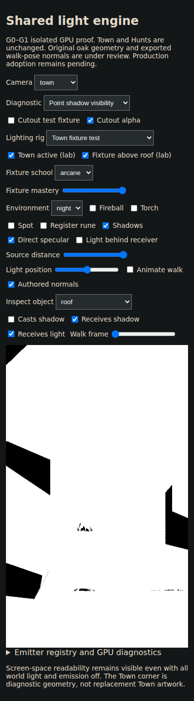

# G1 Town fixture and roof acceptance — 25 October 2026

Original unedited screenshots and measurements from [GPU run 40167497344](https://github.com/pjotrcasteel/Wyrmforge/actions/runs/40167497344), code head `4eb49f6`. Both 320×568 and 390×844 browser tests passed. Complete artifact 12588774219 expires 24 November; checksums and tested PR merge SHA are in provenance.json.

All six schools increase actual wall and NPC illumination from low to high mastery. Vacancy removes the emitter, core and occupant; reactivation restores the frozen frame exactly. Day/night receiver masks are identical. All 20 full-frame zero-light captures have every RGB channel equal to zero. The UI remains readable.

| Viewport | Roof casting changes visible wall shadow pixels |
| --- | ---: |
| 320 | 11,123 |
| 390 | 17,038 |

The roof test holds the source, materials, geometry and camera fixed, masks the visible wall, and toggles only roof casting. It measures actual point-light shadow visibility, not albedo or brightness. Restoration is exact.

These are diagnostic solids and an existing Hollowed NPC proxy, not a Town art rebuild. Color/intensity are lab calibration, not final artistic approval. No production unlock, routing, collision, painting or wizard/actor-art changes. G1 still needs night-readability and temporal acceptance; physical phone profiling belongs to G4 and cannot be inferred from these browser viewports.
