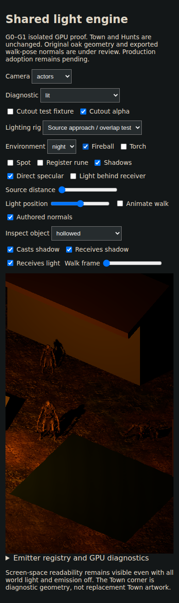
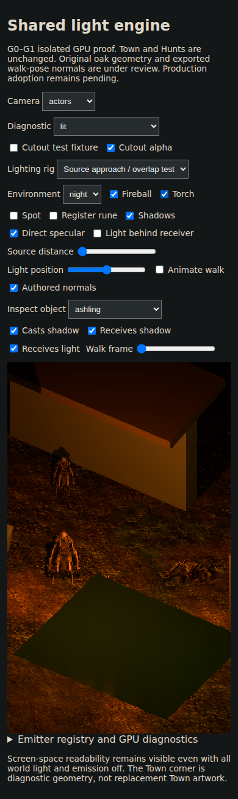

# Actor source lifecycle — 25 October 2026

Original unedited captures from [published-app GPU run 40165163066](https://github.com/pjotrcasteel/Wyrmforge/actions/runs/40165163066), branch head `7253c6b`. Both 320×568 and 390×844 tests passed. Provenance records the tested PR merge SHA and original checksums. Complete artifact 12588420799 expires 24 November.

The actor mask excludes other surfaces; mean RGB is a display-space measurement, not linear radiometric energy. Frozen actors go black outside the 12-unit source range, brighten at distances 8 and 2, and receive additional light from a second source. Removing it restores the exact frame. Disabling both sources makes every framebuffer RGB channel zero, with the page heading still readable. All 18 zero captures passed.

| Actor / viewport | Outside | Entering | Near | Two sources |
| --- | ---: | ---: | ---: | ---: |
| hollowed / 320 | 0.00 | 5.80 | 27.96 | 35.16 |
| ashling / 320 | 0.00 | 2.87 | 20.10 | 24.69 |
| hollowed / 390 | 0.00 | 5.80 | 27.91 | 35.16 |
| ashling / 390 | 0.00 | 2.94 | 20.28 | 24.87 |

The lower-right Ashling and foreground Hollowed use unchanged existing art. These captures validate source/material response; they do not approve night composition or actor artwork. The diagnostic rig disables ambient and emission explicitly. Normal Gothic-night art acceptance, physical mobile profiling and complete Town acceptance remain open. No wizard assets or animation work is included.
