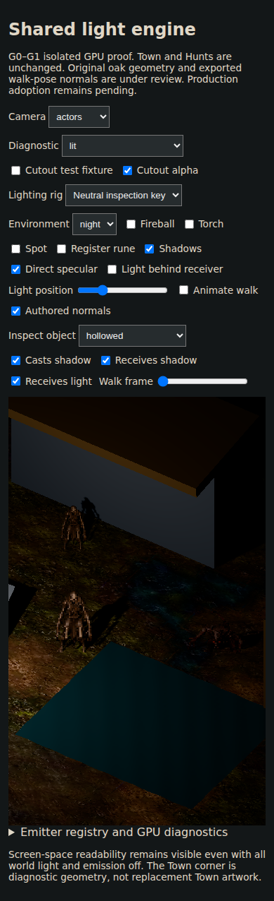
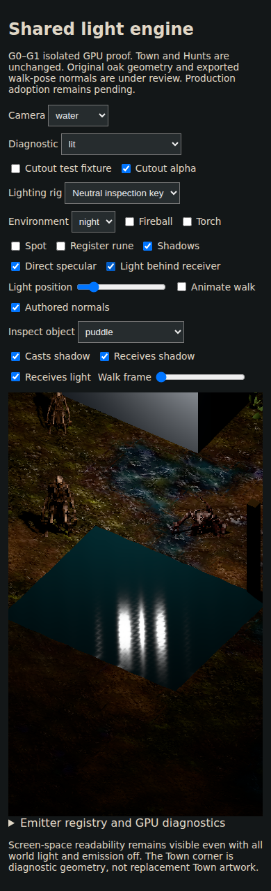
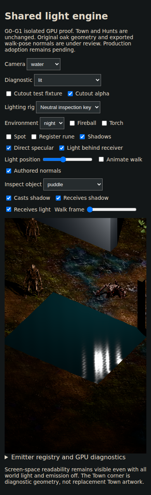
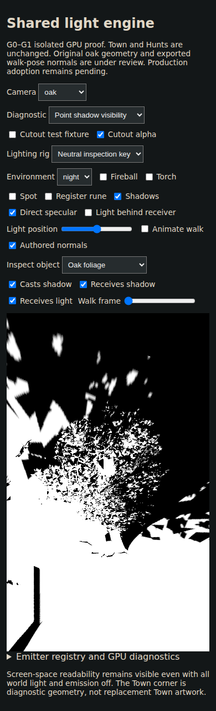
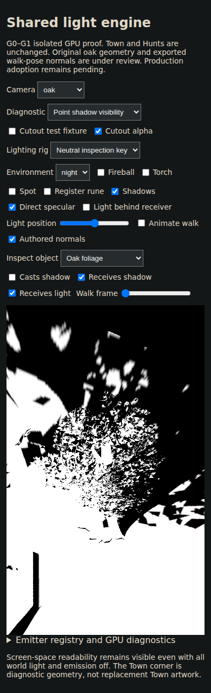

# Actual published-app GPU evidence — eb5cb96

Source: [GPU workflow 40133138866](https://github.com/pjotrcasteel/Wyrmforge/actions/runs/40133138866), artifact 12575776916.
Original unedited Chromium captures, 390×844 viewport. This is not physical-device profiling, approved final art or production adoption.
JSON comparisons include both 320×568 and 390×844 viewports; framebuffer dimensions differ. Provenance includes exact capture SHA-256 values.

## Shared actor binding under an explicit neutral light

## Water: source at 15% and 40%

These are direct BRDF highlights on rippled water, not reflected scenery. The white inspection point is an explicit registered source.

## Original oak: foliage casting on and off

Only oak-1 casting changes. The test measures shadow visibility on visible oak-2 leaf pixels, excluding ground and other surfaces.

