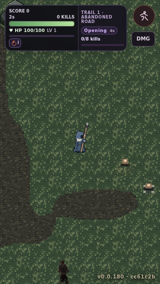
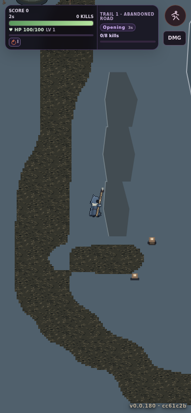
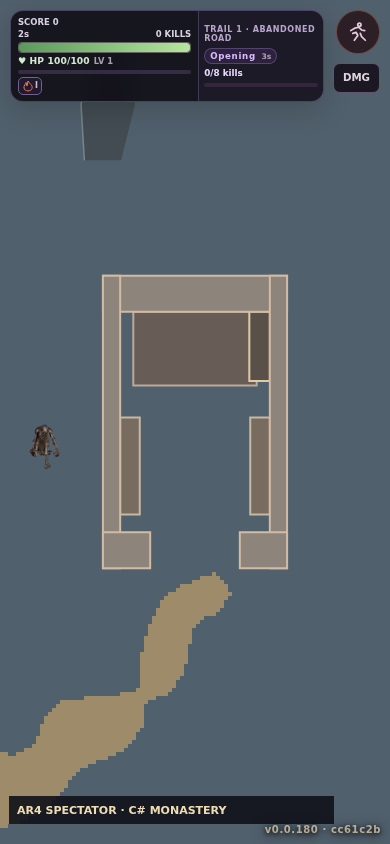

# AR4-B source32 candidate — genuine in-Hunt evidence (1 November 2026)

**Owner approval: NOT GRANTED. Draft PR #459 stays unmerged.** These are three real Playwright screenshots from Town → Chart → playable Hunt, not mockups, generated imagery or source-only art boards. The exact original WF32 #429 atlas is displayed through the isolated `?arenaTerrain=source32` prototype.

- Tested code: [981b317](https://github.com/pjotrcasteel/Wyrmforge/commit/981b317fa6bda202a20431211861bdd0323f200c)
- [Browser run 41288858516](https://github.com/pjotrcasteel/Wyrmforge/actions/runs/41288858516), shard 1 **50/50 passed**, including all three source32 cases.
- Original source: WF32 #429 Git blob `99924850581f7d5218a25ba0b59553aa438c866e`; PNG **232×133** with atlas padding and 22 native 32×32 frames, status `prototype-only`.

## 1. Real 320 × 568 forest fork

## 2. Real 390 × 844 mountain pass

## 3. Real 390 × 844 C# monastery focus

## Honest assessment and remaining source gates

- Improved: real hard-pixel cluster sampling without RGB mixing between terrain classes, at native world-pixel scale. Same C# site/seed, obstacles, navigation, height/grade, movement and rewards.
- Unfinished: obvious repetition across grass tiles; stepped/jagged path borders with no full authored edge and corner transitions; ordinary dirt road is merely a **provisional** reuse of original soil pixels, not an approved road source.
- Still diagnostic: grey mountain rock/cliff polygons, monastery footprint outlines, flagged whole-stone masonry, 2.5D ecology props and all G light/occluder materials. The separately approved P1i continuous world bank still covers only its 1024×1568 window at 390px; repeating source32 tiles do not remove that missing authored coverage.
- Next art task: original 32px road interiors and edge/corner/junction set, varied native grass/soil clusters without a 3-frame checkerboard, then approved whole-stone/rock/cliff and monastery source matched to C# footprints. [Tiled terrain-set documentation](https://doc.mapeditor.org/en/stable/manual/terrain/) explains edge/corner coverage; do not copy reference-pack pixels or silently change P1i/P1j approvals.

**Stop at AR4-B visual owner gate.** Do not merge #459, deploy this prototype, declare AR4-C shadows accepted, or advance AR5 production dressing.
