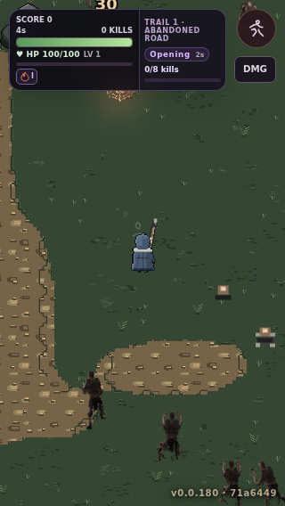
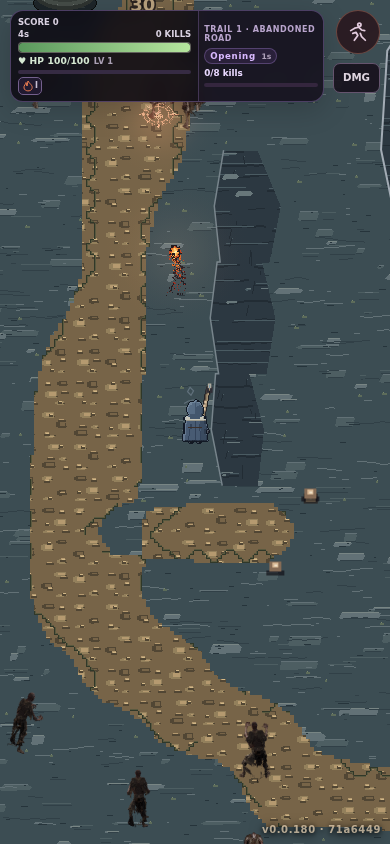
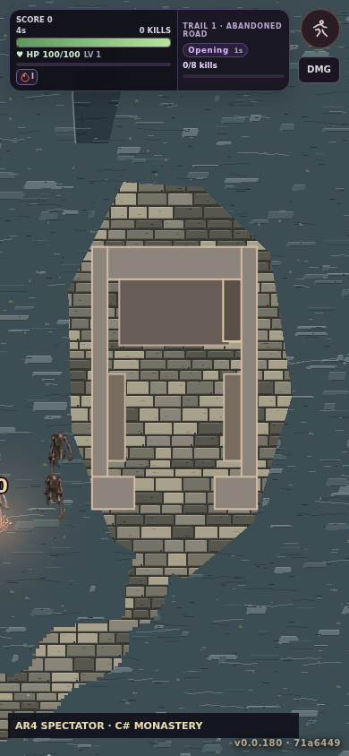

# AR4-B B2 — genuine native-Hunt Wang road comparison (1 November 2026)

> **VISUAL GATE FAILED / NOT APPROVED.** These are screenshots of real playable Town → Chart → Hunt CI, not generated asset mockups. [Draft PR #459](https://github.com/pjotrcasteel/Wyrmforge/pull/459) is **unmerged**; [tracking issue #465](https://github.com/pjotrcasteel/Wyrmforge/issues/465) remains open. This study is a provisional opt-in renderer path only.

[Browser CI run 41298977242](https://github.com/pjotrcasteel/Wyrmforge/actions/runs/41298977242), browser shard **1/4** (job **124826344999**, SUCCESS), source code commit [`610e0c3`](https://github.com/pjotrcasteel/Wyrmforge/commit/610e0c36cfa8573f3371f0a15c064681890a06c1). The actual PNG bytes were recovered from GitHub Actions' `AR4_IMAGE_BEGIN/END` log blocks, checked for PNG signature and dimensions, and **embedded individually** in owner chat. This review retains earlier source32c/source32d comparisons.

## Captures

**Wet Forest fork — 320×568, actual C# Hunt (source32wang):**

**Mountain pass — 390×844, actual C# Hunt (source32wang):**

**Monastery-region ground — 390×844, actual C# spectator review camera:**

## Technical proof (not art acceptance)

- Same site IDs, seeds and obstacle counts as semantic, P1i, source32, source32b, source32c and source32d CI captures. The new mode clips every Wang-road pixel to authoritative 4px C# Road surface winners; all other geometry/rewards/movement untouched.
- Road atlas contains 146 source-pixel frames and 16×8 corner cases (8 interior variations); all 16×16 compatible edge pairs tested, determinism and invalid source rejection pass locally.
- Retains source32c positive forest-world background, source32d provisional mountain rock/cliff and monastery courtyard visuals. No new buildings or engine. The source atlas is decoded once and held in the existing one-site albedo cache; no per-frame source generation.
- CI screenshots demonstrate functional renderer and mode switching. The new atlas is **not** physically profiled or approved for mobile, and screenshots do **not** prove quality.

## Honest visual verdict

1. **Wet Forest:** source32c native background remains the promising baseline. The light road is more legible, but **stone/pebble marks repeat in a conspicuous 32px cadence**. Road interior looks like patterned biscuits, not naturally compacted ground. Edge band too mechanical.
2. **Mountain:** same bad repeated road marks on a long route. Rock top/face still visually flat and diagnostic, despite real C# 1–3m geometry. The authored lip, vertical rock-face fracture and base grammar are missing.
3. **Monastery:** courtyard paving remains too regularly coursed and the building is a flat C# placeholder. **Do not implement/evaluate monastery buildings in this phase**, per owner direction.
4. **Art-source mismatch:** the project already has much richer conceptual Wet Forest **`trampled-earth`, `grass-moss`, `wet-mud`** material images in `user_handover_files/concepts/arena-v2/wet-forest/ground-materials/v1/`. Next source-authoring pass should study their *motifs and cluster hierarchy* (soil ruts, roots, stones, verge vegetation) and author readable 32px primitives; copying giant prelit concept panels or painting new world-size noise is not the solution.

**Next gate:** B1 artistic rework and source edits; B2 genuine Hunt capture again. Then B3 proper 32px cliffs and B4 monastery paving. **Owner AR4-B sign-off is pending, no merge.**
