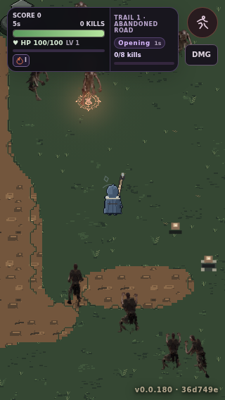
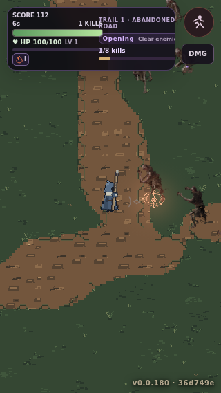

# AR4-BF Wet Forest B1v2 — genuine 320 px Hunt evidence (1 November 2026)

**Status: visual review OPEN; NOT owner-approved.** These PNGs are actual browser-captured gameplay from the C#-authored Forest Fork Hunt at **320×568**. They are neither generated concept art nor a source atlas preview.

| Capture | Evidence |
|---|---|
| Stationary Wet Forest source-Wang v2 |  |
| Moving player and camera, same Forest Fork |  |

- **Source commit:** [`6a9542a`](https://github.com/pjotrcasteel/Wyrmforge/commit/6a9542aa5a07d5150e1acdc7867379de7aa5ec98); opt-in `?arenaTerrain=source32wang` (B1v2); original C# Forest Fork site, seed, navigation, obstacle count and movement authority are unchanged.
- **Real browser proof:** [Browser smoke run 41301049496](https://github.com/pjotrcasteel/Wyrmforge/actions/runs/41301049496), shard 1/4 job `124832413725`, plus all four shards. Six associated workflows completed successfully: Browser smoke, Validate Wyrmforge, Arcane WebKit compatibility, Wet Forest GPU review, Shared GPU lighting proof and Gothic Night Fireball.
- **Authenticity:** extracted from the in-run `AR4_IMAGE_BEGIN`/`AR4_IMAGE_END` PNG output for the browser test; individual native PNGs have been checked as 320×568 RGB images.
- **Visual judgment:** road v2 reduces the rejected regularly spaced pebble cadence of v1, but the brown surface is still flat/sparse, road-bank connection lacks deliberate multi-cell grass/mud→soil→compacted-earth geometry, and the terrain is not yet at the source-authored Fantasy Town reference standard. Pixel size and CI stability are **not** visual sign-off.
- **Scope:** Wet Forest only. Mountain Pass cliff art and monastery ground art remain **parked**, not approved. Monastery buildings remain deferred to AR5. No AR4-C, G, FXP or gameplay topology changes are authorized by this checkpoint.

Owner approval required separately for the Wet Forest BF6 gate. Even forest approval would not approve aggregate AR4-B or merge draft [PR #459](https://github.com/pjotrcasteel/Wyrmforge/pull/459). Track [issue #465](https://github.com/pjotrcasteel/Wyrmforge/issues/465).
