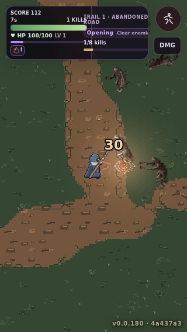
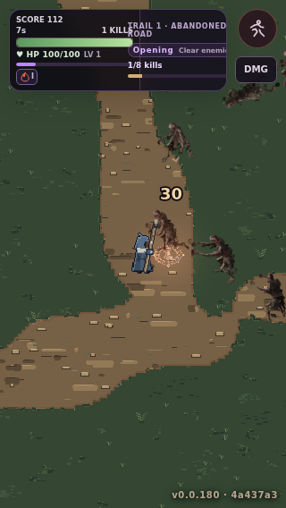
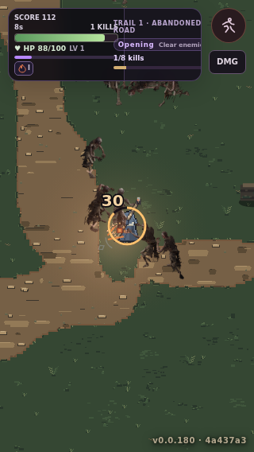

# AR4-BF Wet Forest B1v3 — genuine source-core road comparison (1 November 2026)

**Owner visual gate OPEN. NOT approved. NOT a new physics or world engine.**

These three native **320×568** screenshots were captured by Playwright in the **real Town → Chart → playable C# Forest Fork Hunt** on source commit [`38b4f53`](https://github.com/pjotrcasteel/Wyrmforge/commit/38b4f53f8b85fa73f3f202ef8a71f3fcb38aa121), [Browser smoke run 41313589512](https://github.com/pjotrcasteel/Wyrmforge/actions/runs/41313589512), [browser shard 1 job 124869468145](https://github.com/pjotrcasteel/Wyrmforge/actions/runs/41313589512/job/124869468145). They were extracted byte-for-byte from the job's `AR4_IMAGE_BEGIN` blocks, checked for PNG signature and 320×568 IHDR, and stored as exact Git blob PNGs. No AI-generated/gameplay-simulated imagery.

| Comparison | Actual screenshot |
|---|---|
| Unmodified B1v2 Wang road, already moving |  |
| New B1v3 world-source road core at the same running site after toggling mode |  |
| B1v3 after additional live C# player/camera movement |  |

### Exact change

Opt-in `?arenaTerrain=source32wangcore` preserves existing offline-authored world-phase `ar4b-world/road-world.png` pixels across the *interior* of each C# Road area, while the existing source-authored 32px Wang atlas paints the narrow boundary. Existing `source32wang`, `source32c` and default Hunts remain unchanged. C# AR3 still dictates material winners, site, routes, elevations, obstacles and movement; the G shared renderer and original WF32 #429 source are unchanged. No JS terrain, combat, collision or save authority.

### Honest visual review

- **Technical improvement:** the world-continuous road source's irregular pebble and scuff clusters survive instead of being entirely overwritten by repetitively stamped B1v2 road fill; C# camera motion does not restart the pixel phase.
- **Not yet good enough:** the central road still reads as a wide brown band. Pebble silhouettes are scattered, not deliberately organized into compacted wheel/foot tracks; shoulder mud, verge/roots, narrow grass-to-earth-to-packed-earth transitions and convincing curves/junctions are missing. Grass itself remains under-articulated at mobile zoom. The reference fantasy RPG's distinct 32px cluster/material language is still not met.
- **Next B1v4 art:** source-authored compacted-road core with 1×/3× stress seams, rut/worn/packed variants, actual mud/grass banks on all cardinal/corner and T/X joins. Use original WF32 terrain source rather than giant repeatable stamps; only after native 320px Hunt before/after visual review.

Mountain and monastery art remain parked; buildings are deferred. No AR4-B or AR4-C owner approval, merge or production adoption. Track [`#465`](https://github.com/pjotrcasteel/Wyrmforge/issues/465) and [draft PR #459](https://github.com/pjotrcasteel/Wyrmforge/pull/459).
