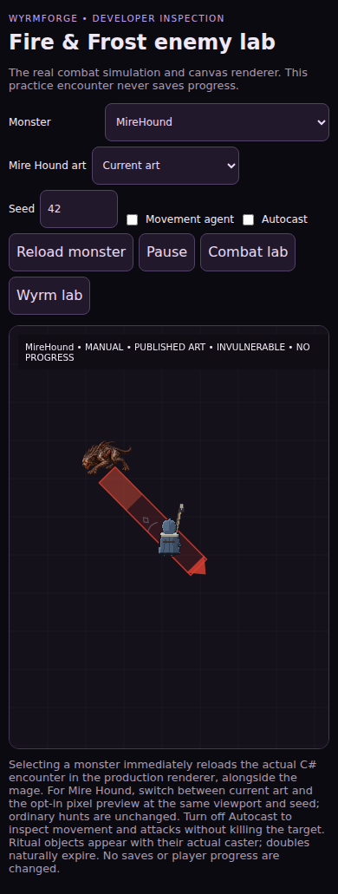
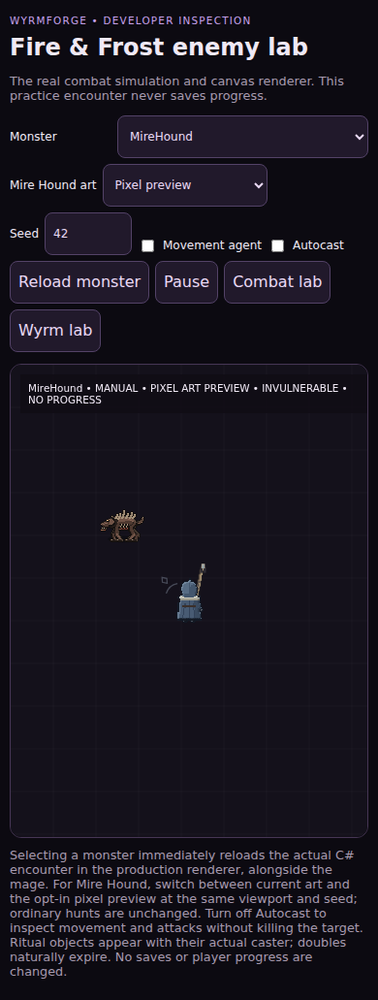

# Mire Hound — single-monster pixel-art recovery (19 October 2026)

**Status: INCOMPLETE / owner visual approval required.** This is a deliberately isolated task; no other Fire/Frost actor is being redesigned.

## Why
Real iPhone acceptance failed on `0.0.125`: Mire Hound was a smooth, detailed painterly cutout scaled over the same scene as the 24×32 hand-authored pixel mage. That fails WyrmForge's approved grounded Gothic pixel-art direction in `art/README.md`.

## Art decisions
- Keep the existing concept card `user_handover_files/concepts/Fire/05-mire-hound.png` and recovered painted originals `art/runtime/enemies/source/mire-hound*.png` in Git, unchanged, as identity/provenance references.
- Use the pre-existing 50×34 Mire Hound world-art bounds, 13-world-unit nominal collision radius, existing 16 pose atlas slots, sharp pixel filtering and the same shared atlas as the mage.
- Re-author the dog as pixel shapes: low long canine silhouette, four distinct articulated limbs, shoulder/haunch masses, exposed ribs, ragged hooked bone ridge, heavy muzzle, amber eyes, restrained brown/bone/ember palette. The card is **not** scaled down into the frame.
- Eight travel-driven diagonal-trot states, four foot contacts, windup crouch, committed pounce, recovery, genuine hurt, and identity-gated corpse. The canonical C# speed, collision and damage remain unchanged.
- Keep existing painterly art in **ordinary hunts** until the owner approves the pixel version on an actual iPhone. Only `/enemy-lab?kind=MireHound&mireStyle=pixel` opts into the new native atlas; the lab skips decoding the superseded painted sheets in this mode.
- Support camera scale and limit per-frame Canvas allocations: authored poses are baked by `tools/art/build-art.mjs` into the shared cached actor atlas.

Research basis already recorded in the recovery handover: Carlisle et al. canine diagonal trot/ground contact (https://pubmed.ncbi.nlm.nih.gov/31122684/) and GDC / Mariel Cartwright on readable anticipation and attack follow-through (https://www.gdcvault.com/play/1021657/Powerful-and-Effective-Animation-for), balanced against the playable WyrmForge mage and the original creature card.

## Checkpoints
- [x] New branch off current main; repository and source checked before edits.
- [x] Authored Mire Hound pixel sprites and game renderer selection pushed remotely.
- [x] Baked `actors.png` and `art/manifest.json` pushed and remote SHA verified by the [Mire Hound atlas workflow](https://github.com/pjotrcasteel/Wyrmforge/actions/workflows/mire-hound-art-checkpoint.yml). `node tools/art/build-art.mjs --check` and the focused JavaScript gait tests passed in that workflow.
- [x] Full .NET validation and 390×844 mobile Chromium browser suite passed on code SHA `11587c7d`. Actual comparison screenshot evidence was published and remote-verified in workflow [39257065616](https://github.com/pjotrcasteel/Wyrmforge/actions/runs/39257065616). This is browser emulation, **not physical iPhone approval**.
- [ ] Compare at **identical zoom and viewport** with original card and pre-change production screenshot.
- [ ] Capture in-game idle/travel/turn/windup/bite/real nonlethal hit/real death; check paw phases against actual world movement.
- [ ] Verify all CI and real browser smoke; obtain owner approval on iPhone before merge.
- [ ] Integrate future real C# lifecycle from draft PR #136 after reconciling with main, not by copying speculative frontend timing. Until then this is **a visual recovery slice, not a finished animation overhaul**.

## Real-game visual comparisons (390 × 844)

Original design authority: [Mire Hound monster card](../../../user_handover_files/concepts/Fire/05-mire-hound.png).

| Current painted version | New authored pixel preview |
|---|---|
|  |  |

These are real Blazor simulation/Canvas screenshots from browser acceptance CI at the same mobile viewport and seed 42. The app's startup overlay was explicitly awaited before recapturing. They demonstrate coherent pixel scale, but **do not** prove all directional, attack, nonlethal-hit, death or iPhone lifecycle acceptance gates. The current build is *preview only*; ordinary hunts are left unchanged.

## Owner comparison (preview only)

After the preview PR is validated and merged, load the same real simulation at a fixed seed, without changing regular hunts:
- New authored native pixel version: `/enemy-lab?kind=MireHound&seed=42&autoplay=false&cast=false&mireStyle=pixel`
- Currently published version: `/enemy-lab?kind=MireHound&seed=42&autoplay=false&cast=false&mireStyle=painted`

Selecting **Mire Hound art → Current art / Pixel preview** in the lab reloads the actual Canvas/simulation and leaves ordinary hunts intact. These links are not a claim that the preview exists on live Pages before merge/deploy.

## Concurrency notes
The unmerged draft PR #136 contains other Fire/Frost lifecycle changes and earlier experimental UI modifications. This task starts from main (including merged developer-lab PR #137) to avoid exposing the rest of the unfinished art overhaul. Reconcile #136 before merging any overlapping edits; do **not** treat passing tests or a published atlas as visual sign-off.
