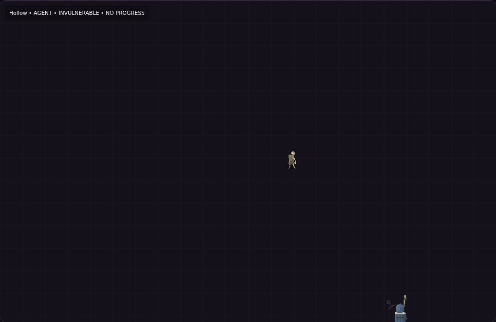
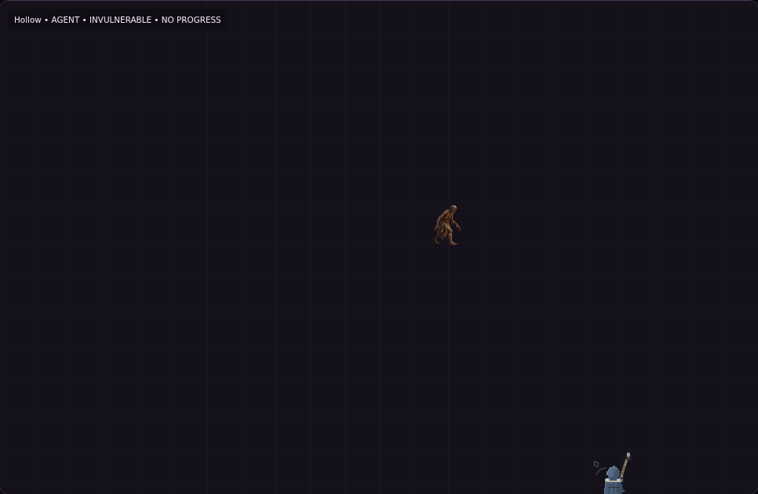
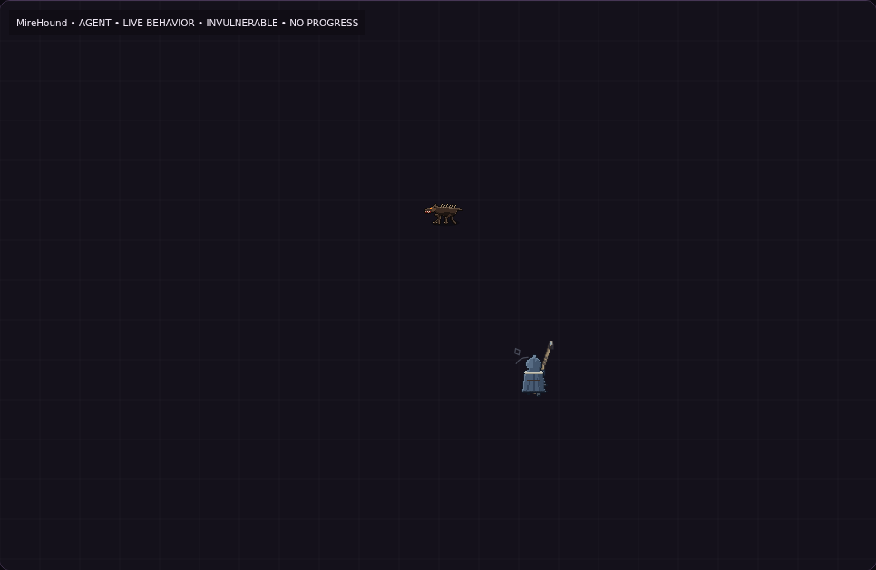
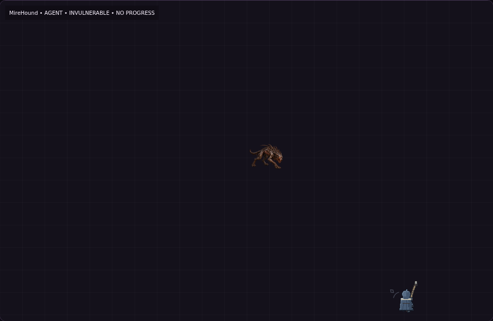
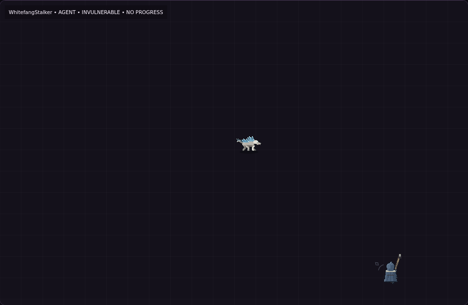
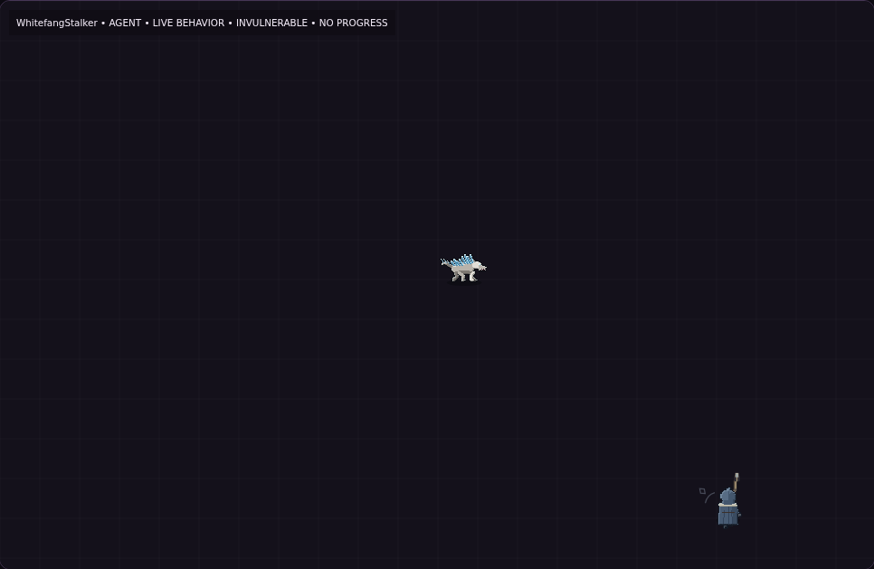
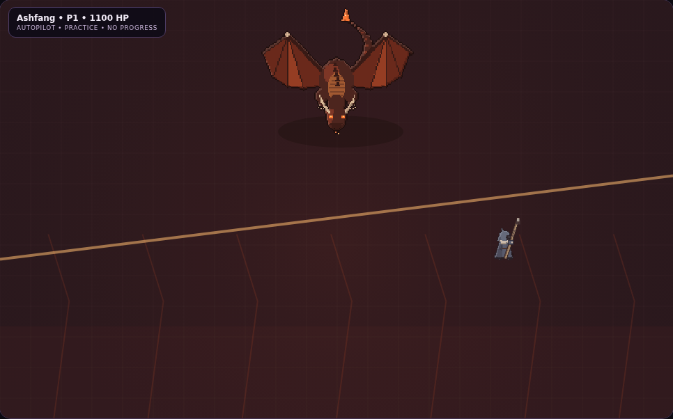
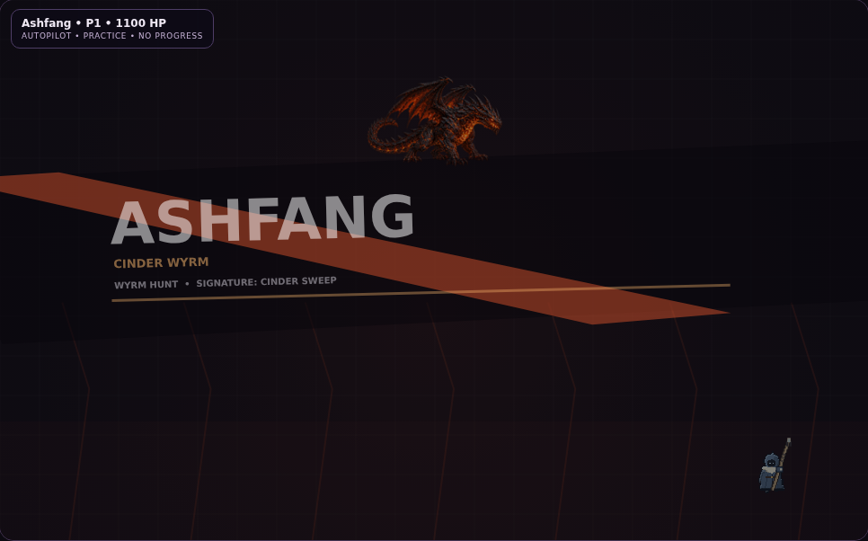

# Combat recovery — 19 October 2026

This is a delivered recovery slice, **not completion of the original all-roster art milestone**. The unpublished checkout, most generated sheets and previous recordings were removed during workspace pruning. Three painted actors were recovered; the remaining roster keeps its native art. Source assets and runtime atlases are now committed together, with frequent remote checkpoints required by AGENTS.md.

## Implemented

- The current authoritative master design §3.3a supersedes movement-facing default fire: automatic targeting is standard; active mouse, right touch or right stick fully overrides it. Release restores automatic targeting. A tap supplies a 350 ms override. Automatic spell cadence and self-centered spells remain intact.
- C# owns effective aim, target selection, swept physical-wall collision and first-link lightning cone. A fast projectile cannot tunnel to an enemy behind a barrier; opening the gate restores the legal path. The snapshot controls the staff and small ground rune. Keyboard/left touch movement remains independent; interrupted gestures and paused maps clear stale intent.
- Painted Hollow, Mire Hound and Ashfang use cached, hash-versioned 768×384 atlases. Mire Hound has a separate eight-frame gait. Both native canines, including Whitefang, have eight articulated travel-driven trot frames and separate attack/recovery/recoil/collapse poses. Facing is mirrored east/west; there is no eight-direction skeletal rig.
- Corpse rendering requires an identity-bearing C# death event; disappearance alone never creates a corpse. Collision radii, damage and attack timing remain authoritative.
- Hunt budgets scale by depth, preserve connected branches and protected relic detours, and retain capped minor refinements. See [actual seeded maps and counts](../hunt-length/README.md).
- `/enemy-lab` uses the actual RunSimulation and production canvas renderer for every implemented Fire/Frost enemy kind. It bypasses saves/rewards and optionally uses the existing movement agent. It is an inspection tool, not an alternative combat implementation.

## Actual game comparisons

Screenshots and clips are from published Blazor builds. **The original Ashfang baseline** uses main `7ba5df2`. **The refreshed Hollow, Mire Hound and Whitefang pairs** use main `5d6b0df` as the before-renderer, with painted art disabled for that baseline. The after frames are captured from [draft PR #136](https://github.com/pjotrcasteel/Wyrmforge/pull/136). Both sides use the **same actual C# simulation**, seed 42, viewport 1000×900, renderer and inspection tools. This isolates the animation/sprite difference. The plain grid is the real renderer's fallback in this inspection setup. Screenshots are actual canvas captures, not generated composites. Open either image to compare at full scale.

| Actor and original card | Before | After | Actual animation |
|---|---|---|---|
| [Hollow](../../../user_handover_files/concepts/Fire/01-the-hollow.png) |  |  | [Before](evidence/before/hollow.webm) · [After](evidence/after/hollow.webm) · [Real contact, hit + death](evidence/after/hollow-lifecycle.webm) |
| [Mire Hound](../../../user_handover_files/concepts/Fire/05-mire-hound.png) |  |  | [Before](evidence/before/mire-hound.webm) · [After](evidence/after/mire-hound.webm) · [Hit + death](evidence/after/mire-hound-lifecycle.webm) |
| [Whitefang](../../../user_handover_files/concepts/Frost/04-the-whitefang-stalker.png) |  |  | [Before](evidence/before/whitefang.webm) · [After](evidence/after/whitefang.webm) · [Hit + death](evidence/after/whitefang-lifecycle.webm) |
| [Ashfang](../../../user_handover_files/concepts/Fire/10-ashfang-the-cinder-wyrm.png) |  |  | [Before](evidence/before/ashfang.webm) · [After](evidence/after/ashfang.webm) |

The baseline clips demonstrate movement and attack behavior during real simulation. Hollow's contact strike is shown only when C# actually resolves overlapping melee contact; it has a bounded recovery and does not change combat damage. **The new 10-second Hollow, Mire Hound and Whitefang lifecycle clips** exercise two real nonlethal C# damage events followed by one genuine C# lethal event in the opt-in `/enemy-lab?artEvents=true` acceptance mode (not in normal hunts). The [recorded results](evidence/after/art-results-hollow-mire-hound-whitefang.json) show both canine phase cycles, Hollow's genuine C# `ContactStrike`/`Recover` sequence, and observed damage flashes and death bursts for **all three** actors. The [before results](evidence/before/art-results-hollow-mire-hound-whitefang.json) use identical simulation and viewport with the old renderer. This still does **not** prove body fidelity from every angle, full lifecycle for Ashfang, actual iPhone performance, or any of the remaining roster.

## Independent aiming

[Desktop recording](evidence/after/desktop-aim.webm) · [Mobile recording](evidence/after/mobile-aim.webm) · [Raw acceptance results](evidence/after/aim-results.json).

Seven browser assertions verify actual movement while aiming independently, mouse release, simultaneous left/right native Chromium touch, touch release, short-lived tap aim and tap expiry. Mobile uses a 390×844 viewport and native CDP touch events. A long-lived Bell Warden prevents an automatic kill from pausing the inspection halfway through an input check. This is Chromium mobile emulation, not physical iPhone Safari validation.

## Engineering evidence

- Final application regression: **511 passed**, including manual aim lifecycle and five swept projectile/wall cases.
- Domain: **329 passed**. JavaScript: **201 passed**. The complete GitHub browser smoke suite passed, including both narrow route-map layouts and native left-thumb movement/release.
- Hunt tests include 800 seeded maps across four depths and Fire/Frost; all routes stay connected and legal, reward stops stay protected, and minor rewards remain capped.
- Enemy-lab tests exercise all 21 kinds for 20 deterministic seconds, confirm isolation from ordinary runs, and verify real lethal damage emits identity-bearing death feedback with its original 0.26-second duration.
- Release web publish passed. Local environment required running WebAssembly build tasks in process because sandbox task-host IPC is unavailable; that workaround is outside the repository.
- Four painted textures require 4.5 MiB decoded RGBA storage. Images are shared and cached; no per-frame texture creation/filtering is used. This is a texture budget, not a physical-device performance benchmark.
- Reproduce native art: `node tools/art/build-art.mjs --check`. Reproduce recovered painted art: install `tools/art/painted-requirements.txt`, then `python tools/art/build-painted-enemies.py --check`.

All three CI workflows passed on code commit `eb41de031254bb7df8be35c1362ce1d8f2a16c76`: validation, browser smoke and focused magic comparison. Final merge status is recorded in [PR #135](https://github.com/pjotrcasteel/Wyrmforge/pull/135). Do not equate this partial recovery with all original art acceptance criteria being complete.

## Research applied

- [Blizzard character art, June 2021](https://news.blizzard.com/en-us/article/23665024/diablo-iv-quarterly-updatejune-2021): preserve large silhouette/material groups at the actual game camera, then retain secondary details. Existing cards remain identity references, not runtime sprites.
- [Carlisle et al., canine trot mechanics](https://pubmed.ncbi.nlm.nih.gov/31122684/): diagonal limb pairing and alternating support informed the native canine articulation and distance-driven phase progression. Generated gait frames are finite authored images, not a biomechanical simulation.
- [Pointer Events specification](https://www.w3.org/TR/pointerevents3/) and [Touch Events specification](https://www.w3.org/TR/touch-events/): independent gesture ownership and cancellation are tested explicitly. See [aim implementation note](../hybrid-aim-2026-10-19.md).

## Remaining original milestone work

The other 18 enemy kinds retain their native art, and Rimeclaw retains its native Wyrm atlas. Their lost painted replacements are not silently presented as shipped. Full roster card-quality art, directional asset expansion, exhaustive hit/death footage, physical Safari checks and human completion-time balance remain unfulfilled. No additional elements, enemy types, bouncing or new spell combinations were added.
