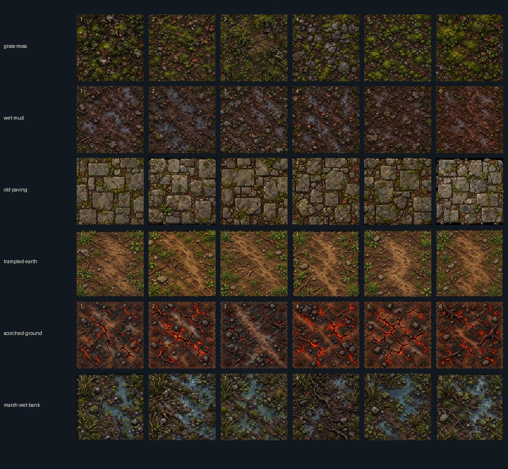

# WyrmForge — Wet Forest ground material concepts v1

**STATUS: REVIEW CANDIDATES — NOT LOCKED, NOT ENGINE-READY.**

This is the owner's requested six-families × six-individual-variations art review collection (36 separate images).
Original source images were generated in ChatGPT in October 2026 and are preserved for visual review
as full-resolution, quality-92 WebP versions. Their original PNG SHA-256 digests and filenames are recorded
in `manifest.json`; the 36 original PNGs were additionally packaged in a conversation backup archive.

## Visual review

Inspect the individual `variant-01.webp` … `variant-06.webp` files inside each family folder at original resolution before deciding which paintings to approve. See the [production-readiness audit](PRODUCTION-READINESS.md) for the observed black-matte borders, baked lighting/reflections, material separation work, and GPU/arena acceptance gates. The contact sheet and artwork remain **review-only**; neither is a game texture atlas.

## Families
1. `grass-moss` — normal wet forest substrate
2. `wet-mud` — damp soil
3. `old-paving` — ruins/settlement context, NOT ordinary forest road
4. `trampled-earth` — path/road core
5. `scorched-ground` — optional fire-Wyrm influence, NOT general terrain
6. `marsh-wet-bank` — saturated terrain and water margins

Each family has `variant-01.webp` through `variant-06.webp`.
`review-contact.jpg` is a downscaled six-by-six visual index, **not** a runtime atlas.

## IMPORTANT — source art is not renderer-ready yet
- These are **concept images**, not verified seamless tiles. At present image borders/edge colors
  do not match. Do not tile them in the Arena Generator and claim seamless transitions.
- Some source art contains dark backgrounds, painted shadows, highlights, red glowing cracks
  or water reflections. They are **not** light-neutral albedo images; extract/author suitable
  maps (albedo, roughness, height/normal, occlusion, emission where applicable) before use.
- Never replace the already-approved six-swatch runtime atlas or bypass the universal GPU lighting
  engine from PR #332. No lighting filters or new renderer.
- Actual in-game review at 320px/390px mobile viewports, material edge blending, repeat variation,
  deterministic layout, and all-light-off black-world proof are required before any runtime migration.

## Reproducible Grass/Moss + Wet Mud source-repeat study

The **first twelve** Grass/Moss and Wet Mud source paintings now have a non-destructive, repeatable QA generator. This is a visual experiment, not a lighting-compatible game texture exporter.

- Run: `python -m pip install Pillow==12.0.0`, then `python -m unittest discover -s tools/art/tests -p test_ground_material_probe.py -v`.
- Generate: `python tools/art/build_ground_material_probe.py --output /tmp/ground-review --tile-px 240` from the repo root.
- Each `*-repeat.jpg` compares a 3×3 repeated original (left) against a 3×3 periodic-border feather study (right). The study intentionally exposes repeating objects, blurred seams, and mismatched world scale; matching border pixels is **not** proof of a high-quality seamless texture.
- The `review-metrics.json` provides original and studied edge-gap diagnostics and immutable source hashes. No output goes into gameplay and nothing updates the source manifest's approval status.
- GitHub Actions' **Wet Forest ground concept integrity** workflow uploads the `wet-forest-grass-mud-repeat-studies` review artifact for each successful PR run (30-day retention). The review pages must still be checked by a human.
- Actual relightable albedo, independent puddle masks, physically meaningful reflection/roughness/normal maps, authored transition/geometry masks, and representative mobile shots must wait for the unified lighting interface in PR #332 and owner approval.

## Verified original-source audit and seam-cut research (25 October 2026)

**All 36 original source PNG SHA-256 digests matched the archive manifest**, and locally re-encoding each original at WebP quality 92 with Pillow method 6 reproduced all 36 committed WebP checksums exactly. The source evidence and per-family border screening are in [SOURCE-AUDIT-RESULTS.md](SOURCE-AUDIT-RESULTS.md).

- 22/36 candidates have a **possible black-matte boundary**, based on a conservative brightness/edge screening rule; this means they need patch/path/shoreline handling rather than raw rectangular repetition. It is not a user art rejection.
- The **six** Grass/Moss and **six** Wet Mud paintings are full-bleed, but lack proven seamless boundaries or light-neutral color.
- `tools/art/quilt_ground_material_study.py` is an optional, deterministic **research-only** six-source seam-cut compositor. It compares naive repetition, periodic edge feathering, and seam-cut quilting for Grass/Moss and Wet Mud. It never writes to the source archive, modifies canonical game materials, certifies seamlessness, or implements lighting.
- Local first-pass review suggests seam-cut sampling reduces obvious repeated landmarks relative to simple 2×2 repeats; future gameplay-scale inspection is still required.
- GitHub Actions `visual-review` now includes unit tests, all-36 source diagnostics, the twelve earlier repeat-probe studies, and the two quilting comparisons in the same downloadable artifact. **Latest CI has not yet been verified green.**

## Diversity-controlled source quilting — research-only checkpoint

The first seam-cut quilt disproportionately reused individual sources (13/25 Grass/Moss patches from one artwork; 16/25 Wet Mud patches from another), despite all six paintings being available. The experimental sampler now attempts each of the six source artworks per patch, then applies a small, deterministic usage penalty (`diversityStrength=0.15`) among visually plausible candidate overlaps. A candidate outside the bounded overlap-error budget (best error ×1.45 + 100 mean-squared RGB units) cannot win solely for variety.

The repeat-study JSON reports `selectedSourceUsage`, `sourcesRepresented` and the actual selection sequence. This improves coverage *without guaranteeing artistic quality or an exact six-of-six result for every seed*. It retains all six original image hashes, any baked highlights, no authored water masks and **no** production materials. The visual-review job and unit tests verify the code; real device screenshots and shared GPU shading remain separate future gates.

## Portrait-size Grass/Moss ↔ Wet Mud material-boundary QA

A standalone `tools/art/ground_transition_study.py` research tool builds four **source-only portrait comparison boards** at **320×568** and **390×844**, using two deterministic seeds. Each board tests the same Grass/Moss and Wet Mud six-source quilts across three *visual-only* transition modes:

- **Hard boundary:** sharp family switch, exposing disconnected material detail.
- **Soft crossfade:** source RGB mixing, exposing blur and muddy/ghosted detail.
- **4×4 ordered coverage dither:** alternating untouched source pixels in the boundary band, preserving the source pixel colors and helping reveal whether the transition remains readable at small sizes.

The wavering test boundary is explicitly **not** a C# `WetForestRecipe`, road shape, puddle distribution, hazard, collision rule, reflection, or procedural gameplay plan. There is deliberately no simulated Fireball, player, material geometry, GPU lighting or baked night overlay in these comparisons. The `transition-study.json` report records seeds, source usage and content hashes. The original paintings and existing game atlas remain unchanged.

Generate from the repository root with `python tools/art/ground_transition_study.py --output /tmp/wyrmforest-ground-source-review`, after installing the pinned visual-review dependencies in the workflow. The draft PR's **Wet Forest ground concept integrity** artifact also contains the preview boards once CI succeeds. These boards are **not** a substitute for the shared GPU-lighting integration, actual iOS/Android inspection, or user approval.

## Explicitly authored puddle study — Wet Mud variant 01

The first visual-only semantic-layer prototype is at [`annotations/wet-mud-01-water-study.json`](annotations/wet-mud-01-water-study.json). It contains **seven hand-positioned UV polygons**, independently hash-locked to the source WebP and original PNG. They tentatively mark major painted puddle areas in one Wet Mud candidate. This is not automatic RGB segmentation: rocks, soil, small bright glints and shorelines cannot be reliably inferred from color alone.

`python tools/art/review_ground_semantic_mask.py --output /tmp/wyrm-water-annotation-review` produces a monochrome, explicitly vector-rasterized *draft* image mask, a source-versus-tinted-annotation comparison, and a JSON report with area and output hash. **About 11% of the artwork** falls inside the initial coarse polygons. The outlines still overlap some ground and miss small puddles. They are not good enough for production water, physically accurate world geometry or renderer source-of-truth.

The tool refuses unknown, tampered or approved source identities; it rejects unexpected polygon coordinates, and cannot write inside the immutable art archive. All generated files carry `UNAPPROVED` names and never enter game code. This source annotation is an editable review milestone—not a finished albedo, normal, roughness, reflectance, depth, shoreline or physics authoring solution.

Do not promote the annotation to a reflection material, C# wetland geometry, or runtime map until the artist refines it, the owner approves the variant, and the **same universal GPU lighting system** from PR #332 passes its proper receiving/reflection and mobile validation gates.

## Full material-family production pass — 36 concepts, all six roles

All six families now have **explicit offline production roles** in [`material-family-roles.json`](material-family-roles.json). This catalog does not assign game collision, physics, approval, texture tiling or rendering ownership. It separates the two potential continuous substrates (Grass/Moss, Wet Mud) from four author-controlled features (historical paving, trampled road art, Wyrm scorch, wetland banks). The last four require semantic world footprints and may **never** be turned into square repeating floor textures merely because their source has dark margins.

Run `python tools/art/ground_family_footprint_review.py --output /tmp/wyrm-all-families` to create 12 **full portrait-size source-art inspection sheets** (six families × 320×568 and 390×844). Every sheet displays all six original candidates with a 112px-size artwork view, a smaller readability sample and a pair of raw 2×2 repeats. Dark borders remain visible, rather than being mislabeled transparent. `family-role-review.json` includes all six roles, output hashes and nonapproval flags. The CI art-review job also publishes these images.

This is an **all-family scale/asset-selection checkpoint**, not an alternate Arena Generator or a rendered Hunt. Do not confuse a phone-sized review *canvas* with a physical-phone gameplay screenshot. The scale and blending of actual C# routes, obstacles and terrain belongs to the existing one-road PR #338 and the GPU renderer in PR #332 after integration. Do not derive gameplay paths, water surfaces, occluders or colored emission from raw source pixels.

**Status:** 36 source concepts archived; semantic family roles defined; offline mobile-footprint review available. No variant is locked, no physical channel has been approved, and no production texture has been exported. The clean, user-liked second puddle image is a visual guide only; it must not displace hash-checked source images or be mistaken for a ready geometry mask.

## G1-independent painted-feature extraction studies — 25 October 2026

**The universal lighting engine PR #332 is still G1. No G2/G3 renderer, scene integration, or production material adoption has been done or claimed here.** Continue preparing source art independently in PR #340 while G1 closes.

The [explicit source-art motif annotation file](annotations/feature-motif-source-studies-v1.json) contains first editable, **coarse**, hash-locked UV boundaries for:
- `trampled-earth-01`: painted diagonal trail details, *not* the route, physics, navigation, or a generated road;
- `scorched-ground-01`: painted scorched-island region, **not** authored emission or a registered world light;
- `marsh-wet-bank-01`: painted marshland composition, **not** a water-surface mask, reflective receiver, or C# wetland.

Run `python tools/art/review_ground_feature_motifs.py --output /tmp/wyrm-source-feature-previews` using the same pinned Pillow CI environment. The script verifies the exact original WebP hashes, the originating PNG hashes in the source manifest, explicit UV geometry and the [six-family role catalog](material-family-roles.json). It creates separately labeled *unapproved* masks and side-by-side preview images plus machine-readable metrics. **The masks are only source-art selections, never actual world geometry/alpha/transparency or GPU material channels.** The artist must refine the coarse boundaries. It is intentionally impossible to interpret the current source annotations as game routes or glow.

G1-independent authoring still possible after this checkpoint: refine the selected candidate regions, preserve source layers, author truly neutral diffuse material without assuming painted highlights are physically accurate, record independent semantic water/emissive regions, and test their pixel scale/shape in source-only previews. **Only after G1 acceptance** may a separate integration PR load accepted material layers through PR #332's existing shared lighting/material descriptors and the C# terrain/road truth from PR #338. No custom material lighting renderer, CSS tint or inferred geometry.

## Grass/Moss — six reproducible terrain-art candidates (26 October)

The first **actual derived visual assets** (not just diagnostic masks) are generated by
`python tools/art/build_grass_moss_art_candidates.py --output /tmp/wyrm-grass-candidates`.
The output contains **six 900×900 individual PNG candidate textures**, a single six-panel
2×2 repetition contact sheet, and a JSON production/review receipt with SHA-256, source
usage per candidate, and precise seam/detail measurements.

**Method:** six hash-verified Grass/Moss WebP paintings → six-source deterministic
minimum-error patch quilting (different seeds) → Fourier *periodic plus smooth*
boundary correction → exact one-pixel opposite-edge parity. This removes the
color step of the tiled seam without blurring the entire source boundary with a
translucent band. Each candidate samples **all six** original variations.
Regression tests verify source immutability, deterministic dimensions, wrap-border
continuity, and a relative local-gradient bound. The dedicated art CI publishes
the candidate PNGs as an artifact without writing them into gameplay directories.

**Important distinction:** exact matching opposite edge *pixels* does **not**
certify believable repeating landmarks, seamless composition between **different**
candidate images, scene/world scale, a usable neutral albedo, or physically authored
normals, depth or water. The original highlights are still painted. A 2×2 repeat
of a single candidate still reveals some clusters; the six trials require
real art-direction review/refinement. They are not artist-approved, not engine
assets and are not adopted by any game renderer.

No lighting milestone code, tests, documents or integration paths were changed.
This task remains strictly material **art creation** while G1–G5 ownership stays
with separate Work sessions. Keep this PR draft.

## Cross-variant Grass/Moss art bank — interchangeable edges, still under artistic review

The initial six candidate PNGs are individually periodic, but unlike variants
still need a compatible border. The **art-only**
`tools/art/build_grass_moss_compatible_bank.py` builds an *additional*
six-PNG bank, retaining the existing six independent samples for comparison.

Each compatible bank image uses the first source-backed candidate's exact outer
perimeter as a shared **32-pixel transition reference**. The remaining
interior retains its different Grass/Moss composite. This creates **72 exact
pairwise horizontal/vertical edge matches** (all ordered pairs of six variants).
An art-only 3×3 layout made of unlike variants is exported for review. No
C# scene geometry, road or lighting engine is touched.

**Artistic warning:** repeated shared-border motifs can produce a perceptible
grid even when the seam pixel measurements are zero. The narrow 32px band was
preferred in a source-only comparison to a much wider band, which produced
soft/stamped-looking edges. This is an intermediate **trial art set**, not
the final production atlas, no guarantee of non-repeating visual rhythm and
no relightable or neutral albedo. The two banks can be compared and revised
without discarding originals or triggering integration. Genuine game-scale
art review is still required.

## Approval/locking protocol
**Do not rename this folder CANONICAL or update runtime references until the owner explicitly accepts
these 36 images.** After approval, record approved image hashes in an immutable manifest
and commit the production source derivatives separately for the shared renderer. This review branch
is intentionally isolated from concurrent engine and arena-generator work.

The old rejected oak/forest assets are not used in this collection.
